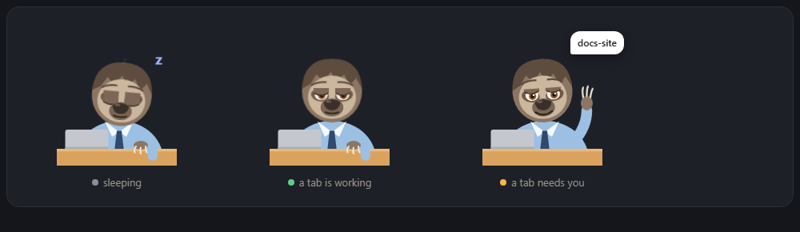

# Clumsy Sloth

A slow, friendly sloth that sits on your Windows desktop and keeps an eye on every
[Claude Code](https://claude.com/claude-code) tab you have open in VS Code.



- **Sleeps** when no tab is working, **types** while a tab works, **waves** when a tab needs you.
- Says what happened in a slow speech bubble: *"docs-site... is... done..."*.
- **Click it** to see all tabs with their status. Click a row to jump straight to that tab.
- **Permission cards**: when a tab asks for permission, the same question shows up on the sloth
  at the same time. Answer in either place. The other one closes by itself.
- Only shows tabs that are really open. Closed tabs drop off the list within seconds.
- Drag it anywhere, minimize it, or close it with the × on hover. It remembers its spot.
- English and Turkish UI (follows your Windows language).

## Requirements

- Windows 10 or 11 (uses the built-in Windows PowerShell 5.1, nothing to install)
- [Node.js](https://nodejs.org) 18 or newer (runs the two small hook scripts)
- Claude Code in VS Code (the extension)

## Install

```powershell
git clone https://github.com/ministeraskol/clumsy-sloth.git
cd clumsy-sloth
node install.js
```

The installer:

1. backs up your Claude Code `settings.json` to `settings.json.clumsy-sloth.bak`,
2. adds two hooks to it (`hooks/status.js` for tab status, `hooks/permission.js` for permission cards),
3. adds a login entry so the sloth starts with Windows,
4. starts the sloth (bottom-left of your screen).

The sloth runs from the folder you cloned, so keep the folder where it is.
Already open tabs pick up the hooks with their next message.

## Uninstall

```powershell
node install.js --uninstall
```

This removes the hooks and the login entry and stops the sloth. Then delete the folder.

## How it works

| Part | What it does |
| --- | --- |
| `panel.ps1` | The sloth itself: a WPF window drawn in code, run by Windows PowerShell. |
| `hooks/status.js` | Claude Code hook. Writes each tab's status to `data/sessions/`. |
| `hooks/permission.js` | Claude Code `PermissionRequest` hook. Puts the request on the sloth and waits for Allow / Deny. |
| `start.vbs` | Starts the sloth without a console window. |
| `config.json` | Created on first run: position, size, language. |

**Permissions.** In the VS Code extension the hook and the tab's own prompt run side by side, and the
first answer wins. If you answer on the sloth, the tab's prompt closes. If you answer in the tab,
the hook sees the tool's result in the session transcript and removes the card. In tabs running
with `bypassPermissions` or `dontAsk`, nothing is ever asked, so the sloth shows no cards there.

**Open tabs.** Claude Code keeps a small file per running process in `~/.claude/sessions/`.
The sloth reads it to know which tabs are still open, so a closed tab never stays on the list.

## Settings

`config.json` (next to `panel.ps1`):

| Key | Meaning |
| --- | --- |
| `lang` | `"en"` or `"tr"`. Empty = Windows language. |
| `askMarker` | Optional regex. When Claude's last reply contains it, the tab shows as *waiting for you* instead of *done*. Example: `"Your turn\\s*:"`. |
| `left`, `top`, `mini` | Saved position and size. Right-click the sloth → *Back to bottom-left* to reset. |

Adding a language: copy `lang/en.json` to `lang/<code>.json`, translate it, and set `"lang": "<code>"`.

## Privacy

Everything stays on your computer. The sloth only reads Claude Code's local files and writes to its own
`data/` folder. Nothing is sent anywhere.

## License

MIT. The sloth drawing is original art made for this project.
